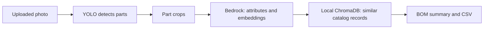

# Runbook: Vision-Based Product Attribution and BOM Mapping

This guide is for two audiences: people who only need to use the app, and people who install or support it. The app is a prototype that analyzes photos of mechanical parts.

## 1. What the app does

The app takes a photo and creates a visual parts report:

1. YOLO looks for bearings, bolts, gears, and nuts.
2. The app displays the detections and crops each detected part.
3. Amazon Bedrock services analyze the part crops for visible attributes and create image embeddings.
4. The app searches the local ChromaDB catalog for visually similar records.
5. The BOM Summary tab combines the results and lets the user download a CSV.



**Important:** This is a visual-assistance prototype. A similarity score means that images look alike; it does not prove a manufacturer, SKU, or part number. Catalog records may be synthetic and unverified. Treat the report as a starting point for human review, not as an authoritative engineering BOM.

When a user runs **Identify Parts**, detected part crops are sent to Amazon Bedrock for attribute extraction and image embedding. Use only images that are permitted to be processed by that service.

## 2. Quick guide for app users

A project administrator should complete the setup in section 3 first. After that, app users do not need to edit code or configure model files.

### Start the app

1. Open a terminal in the project folder.
2. Activate the project's Python environment:

   ```bash
   source .venv/bin/activate
   ```

3. Start the app:

   ```bash
   streamlit run streamlit_app.py
   ```

4. Open the local address printed in the terminal. It is usually <http://localhost:8501>.

### Analyze an image

1. In **Upload & Detection**, upload a JPG, JPEG, PNG, or WEBP image.
2. Keep the sidebar settings at their defaults for a first attempt.
3. Click **Identify Parts** and wait for the detection and analysis to finish.
4. Review the detected parts. If none appear, try a clearer image or lower the YOLO confidence threshold.
5. Open **Parts** to review a part's **Attributes** and **Catalog matches**.
6. Open **BOM summary** to review all parts together. Click **Download BOM as CSV** to save a spreadsheet.

### What the settings mean

- **YOLO confidence threshold:** How certain the detector must be before showing a part. Lower it to include more possible detections; this can also add false detections.
- **YOLO IoU threshold:** Controls how overlapping boxes are handled. The default is suitable for normal use.
- **Merge similar detections:** Groups likely duplicate detections of the same class to estimate quantities.
- **Top K similar results:** How many catalog candidates to show for each part.
- **Minimum similarity threshold:** Hides candidates below the selected visual-similarity score. Lowering it shows more candidates, including weaker matches.

Similarity is not a confidence score and is not a probability that a candidate is the correct product.

### Stop the app

Return to the terminal running Streamlit and press **Ctrl+C**.

## 3. Technical setup

### Requirements and project assets

- Python 3.11 or newer.
- Python packages from `requirements.txt`.
- YOLO weights at `models/machine_parts_best.pt`.
- A ChromaDB index at `data/chroma_nova_db/` containing the `mechanical_parts_nova` collection.
- A valid Amazon Bedrock bearer-token API key for Claude attribute extraction and Nova image embeddings.

The project includes the model weights and a local ChromaDB directory in this working copy. The `data/` folder is local project data and is excluded from Git; preserve or restore it when setting up another machine.

### First-time installation

Run these commands from the project root:

```bash
python3 -m venv .venv
source .venv/bin/activate
python -m pip install --upgrade pip
python -m pip install -r requirements.txt
cp .env.example .env
```

Edit `.env` and set `BEDROCK_API_KEY`. `AWS_REGION` defaults to `us-east-1`. The `BEDROCK_BASE_URL` setting is only needed by some notebooks. Do not share or commit `.env`.

On Windows PowerShell, activate the environment with:

```powershell
.venv\Scripts\Activate.ps1
```

### Start and configure

Standard start:

```bash
streamlit run streamlit_app.py
```

Convenience launcher:

```bash
./dev.sh
```

To use a different model checkpoint:

```bash
YOLO_MODEL_PATH=/path/to/model.pt streamlit run streamlit_app.py
```

To choose another port:

```bash
STREAMLIT_PORT=8502 ./dev.sh
```

Keep the terminal open while the app is in use. The terminal displays startup messages and errors. Stop the process with **Ctrl+C**.

### Main files and data

| Path | Purpose |
| --- | --- |
| `streamlit_app.py` | Streamlit user interface and workflow |
| `src/detection.py` | YOLO model loading, detection, and part crops |
| `src/attribute_extraction.py` | Claude attribute extraction through Bedrock |
| `src/embeddings.py` | Nova image embeddings through Bedrock |
| `src/retrieval.py` | Similarity search in ChromaDB |
| `src/config.py` | Model and catalog paths; supports `YOLO_MODEL_PATH` override |
| `models/machine_parts_best.pt` | YOLO weights used by default |
| `data/chroma_nova_db/` | Local similar-product index |
| `notebooks/` | Experiments and data exploration notebooks |
| `test_images/` | Sample images for trying the interface |

## 4. Troubleshooting

| Symptom | Checks and actions |
| --- | --- |
| App does not start: `streamlit: command not found` | Activate `.venv`, then run `python -m pip install -r requirements.txt`. |
| Port 8501 is already in use | Start on another port: `STREAMLIT_PORT=8502 ./dev.sh`. |
| YOLO status reports missing weights | Confirm `models/machine_parts_best.pt` exists, or set `YOLO_MODEL_PATH` to a valid checkpoint. Restart the app after changing it. |
| No parts are detected | Try a clear, well-lit image with visible parts. Lower the confidence threshold in the sidebar and click **Identify Parts** again. |
| ChromaDB status reports an error | Confirm `data/chroma_nova_db/` exists and contains the `mechanical_parts_nova` collection. Detection can still work without catalog matches. |
| Bedrock attribute or embedding request fails | Check `BEDROCK_API_KEY`, `AWS_REGION`, network access, and that the account can call the required Bedrock models. The key belongs in `.env`, not in source code. |
| Bedrock requests are throttled | Lower the sidebar setting for simultaneous Bedrock calls and retry. |
| Similarity scores seem unexpected | Scores describe visual resemblance. They do not validate SKU identity. Review the candidate image and metadata manually. |
| An output is missing or stale | Re-run **Identify Parts** after changing the image or detection settings. For attribute errors, use **Re-extract attributes** for that part. |

## 5. Glossary

- **Detection:** A part region found in the uploaded image, shown with a box and class label.
- **Confidence:** YOLO's score for a detection. It describes the detector's certainty about the class/box, not the product identity.
- **Embedding:** A numeric representation of an image used to find visually similar catalog images.
- **ChromaDB:** The local database that stores catalog embeddings and product metadata.
- **BOM:** Bill of Materials. In this prototype, it is a downloadable summary of the parts detected in the submitted image.
